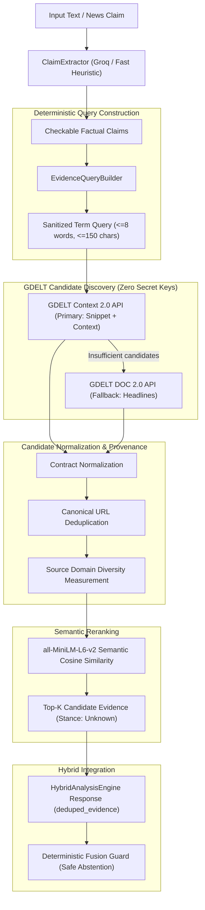

# V2.2 Real-World Live Evidence Discovery (GDELT Context & DOC 2.0)

## 1. Executive Summary

Version 2.2 introduces **real-world, web-based, provenance-bearing news evidence discovery** into the Fake News Detection pipeline. This capability addresses a fundamental epistemic limitation of earlier versions: the cold-start absence of external evidence in production mode.

By integrating the public **GDELT Context 2.0 API** and **GDELT DOC 2.0 API**, the system can search global news coverage in near-real-time without requiring:
- Any additional API keys or paid search subscriptions (the sole project secret remains `GROQ_API_KEY`).
- Webpage scraping, HTML parsing, or headless browsers.
- Unbounded LLM calls for query generation.

Every retrieved candidate carries auditable provenance (canonical source URL, publisher domain, publication timestamp, and snippet content).

---

## 2. Core Epistemic Distinction: Discovery vs. Truth

> [!IMPORTANT]
> **GDELT is an evidence DISCOVERY engine, NOT a truth oracle.**
> An article indexed by GDELT represents published journalistic or media coverage; it does NOT automatically constitute:
> - Confirmed factual truth
> - Endorsed factual claim
> - Verified evidence
>
> Therefore, in Version 2.2:
> 1. All retrieved items are formally designated as **"candidate evidence"** or **"retrieved news evidence candidates"**.
> 2. The stance of all live evidence items is strictly set to **`EvidenceStance.unknown`**.
> 3. Version 2.3 will perform explicit LLM-based claim-evidence stance reasoning (support vs. refute vs. neutral) and cross-source corroboration.
> 4. Under Version 2.2, the deterministic fusion engine continues its safe abstention (`unverifiable`) when evidence stances are unknown or unverified.

---

## 3. Architecture & Data Flow

---

## 4. Subsystem Components

### 4.1. Deterministic Query Builder (`backend.app.services.evidence_query_builder`)
- **Zero LLM overhead**: Builds clean search queries deterministically using standard NLP tokenization and filtering.
- **Safety**: Strips dangerous GDELT search operators (`near:`, `repeat:`, `tone:`, quotes, commas, parentheses).
- **Entities & Numbers Preserved**: Preserves capitalizations (e.g., `NASA`, `Pandora`, `Vietnam`), numerical quantities (`$150M`, `2026`), and key nouns while removing common stop words.
- **Length Bounded**: Capped at 150 characters and a maximum of 8 terms to prevent search engine timeout or denial of service.

### 4.2. GDELT Client (`backend.app.services.gdelt_client`)
- **Public Endpoints**:
  - Context 2.0: `https://api.gdeltproject.org/api/v2/context/index`
  - DOC 2.0: `https://api.gdeltproject.org/api/v2/doc/annotations`
- **Polite Request Pacing**: Thread-safe request spacer enforcing a minimum 3.2-second interval between outbound calls to conform to public GDELT fair-use guidelines.
- **In-Memory TTL Cache**: Cache keyed on query and mode with a 300-second TTL to eliminate duplicate network queries.
- **Graceful Error Handling**: Maps HTTP 429 rate limits, socket timeouts, and 5xx errors into structured metadata without raising uncaught exceptions.

### 4.3. Live Evidence Retriever (`backend.app.services.live_evidence_retriever`)
- **Canonical URL Deduplication**:
  - Strips tracking parameters (`utm_*`, `ref`, `fbclid`, `gclid`).
  - Normalizes scheme to lowercase and strips trailing slashes and fragments (`#`).
- **Domain Diversity**: Computes unique top-level/registered domains among candidates.
- **Semantic Reranking**: Encodes claim and candidates with `sentence-transformers/all-MiniLM-L6-v2` to compute cosine similarity scores, placing the most semantically relevant coverage at rank 1.
- **Candidate Quality Tags**:
  - `context_snippet`: Rich surrounding sentence context extracted from Context 2.0 API.
  - `headline_only`: Headline/title match from DOC 2.0 API fallback.

---

## 5. Verification & Test Isolation

All unit and integration tests strictly enforce **zero external network access** via socket mocking:
- Real sockets are disabled with an autouse pytest fixture (`socket.socket.connect` raises `RuntimeError`).
- Mock responses test all edge cases: JSON parsing, missing fields, rate limits, server errors, empty matches, URL canonicalization, domain counts, and hybrid engine degradation.
- Real connectivity is validated exclusively through explicit diagnostic scripts:
  - `scripts/check_live_evidence.py`: Quick smoke test verifying live GDELT response contracts.
  - `scripts/demo_live_evidence.py`: Multi-claim demonstration on diverse news domains.
