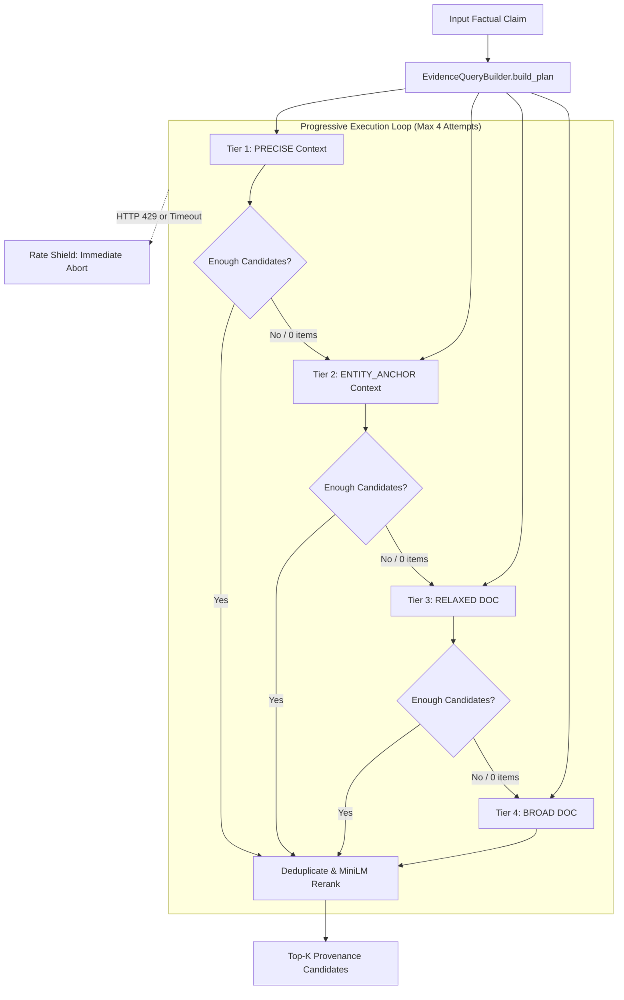

# Post-V2.6 Engineering Patch: Retrieval Robustness & Deterministic Query Relaxation

## 1. Executive Summary

This engineering patch resolves an information-retrieval recall failure observed in live production without retraining any models, altering classification thresholds, or weakening epistemic abstention policies. 

Prior to this patch, the live evidence retrieval component constructed single-attempt queries with up to 8 terms conjoined as an implicit boolean AND. When submitted to the GDELT Context 2.0 API—which indexes individual sentences within a tight temporal horizon (~72 hours)—these queries frequently yielded zero candidate articles even for prominent global news events (e.g., the 2026 Nobel Prize announcements). Because the hybrid engine requires corroborating provenance-bearing evidence to verify claims, zero discovered candidates triggered safe abstention (`unverifiable`).

This patch implements a **4-tier deterministic progressive query relaxation plan** paired with an **early stopping policy** and **rate-limit/timeout shielding**. Search recall is substantially improved while maintaining strict adherence to rate limits, public endpoint etiquette, and all frozen safety invariants.

---

## 2. Problem Statement & Observed Failure

In production testing on the web interface and diagnostic scripts, legitimate factual claims frequently resolved to `UNVERIFIABLE`:

```text
Claim: "The 2026 Nobel Prize in Physiology or Medicine was awarded to three scientists for work that led to using light to study brain activity."
Generated Query: "Nobel Prize" Physiology Medicine awarded three scientists work led
Result: GDELT Context 0 items -> GDELT DOC 0 items -> Deduplicated count: 0 -> UNVERIFIABLE
```

While GDELT connectivity was functional (as confirmed by neutral smoke checks such as `"solar energy capacity"`), realistic factual claims failed to match articles.

### Root Cause Analysis

1. **GDELT Context 2.0 Sentence Horizon:** GDELT Context searches sentence-level extracts rather than entire article texts. Journalistic sentences rarely contain 6 to 8 content words from a claim simultaneously in a single sentence.
2. **Implicit Boolean Conjunction:** Space-separated search terms in GDELT are evaluated as strict conjunctions ($T_1 \land T_2 \land \dots \land T_k$). As the number of terms increases, result set cardinality approaches zero exponentially.
3. **Temporal Inelasticity:** The initial implementation used a fixed 72-hour window for Context and a default 24-hour window for DOC, causing news items published earlier in the week or month to be missed.
4. **Single-Attempt Monolithic Architecture:** The query builder generated only one monolithic query string. If that query returned zero matches, no structured relaxation was attempted.

---

## 3. Architecture: Progressive Query Relaxation

To solve this issue deterministically, `EvidenceQueryBuilder` and `LiveEvidenceRetriever` were refactored to support a progressive, multi-tier search plan.

### 3.1 Four-Tier Query Hierarchy



The 4 progressive tiers operate as follows:

| Tier | Strategy | Target Endpoint | Query Formulation | Typical Term Count |
| :--- | :--- | :--- | :--- | :--- |
| **1** | `precise` | GDELT Context 2.0 | Exact quoted phrase + year + top 2 entity terms | 3–4 terms |
| **2** | `entity_anchor` | GDELT Context 2.0 | Primary entity anchor + claim-derived OR group: `Anchor (Term1 OR Term2)` | 2–3 terms |
| **3** | `relaxed` | GDELT DOC 2.0 | Entity phrase or top 2 salient nouns | 2 terms |
| **4** | `broad` | GDELT DOC 2.0 | Broad entity anchor / high-signal keyword with extended timespan (`timespan=3m`) | 1–2 terms |

### 3.2 Deterministic Extraction Rules
- **Explicit 4-digit Year Detection:** RegEx matches years `\b(19\d\d|20\d\d)\b`. If the year is prior to 2026, the query is marked as historical and routes directly to DOC 2.0 with expanded timespan.
- **Quoted Entity Grouping:** Multi-word capitalized phrases (e.g., `"Nobel Prize"`, `"Electric vehicle"`, `"Artificial intelligence"`) are identified and enclosed in quotes to preserve phrase boundaries.
- **Salience Prioritization:** Entities, numbers, and proper nouns take precedence over low-information action verbs (e.g., *awarded*, *announced*, *invested*).
- **Injection Neutralization:** Special operators such as `domain:`, `repeat:`, `near:`, `OR`, `AND` are stripped from user text before building the query plan.

---

## 4. Rate-Limiting & External Service Shielding

To protect public GDELT infrastructure and prevent cascading request failures, the execution engine enforces strict defensive boundaries:

1. **Maximum Sequential Attempts:** Capped at `LIVE_EVIDENCE_MAX_ATTEMPTS = 4`.
2. **Early Stopping:** The loop terminates immediately when `len(deduplicated_candidates) >= LIVE_EVIDENCE_SEARCH_STOP_COUNT (5)`. If Tier 1 satisfies this threshold, Tiers 2, 3, and 4 are never fired.
3. **Pacing / Politeness Interval:** A minimum interval of `GDELT_MIN_REQUEST_INTERVAL = 1.0s` is enforced between consecutive HTTP requests.
4. **Rate-Limit & Timeout Shield:** If any attempt encounters an HTTP 429 (rate limited), socket timeout, or 5xx server error, the retriever **immediately halts remaining attempts**. It records `stop_reason = aborted_rate_limited` or `aborted_timeout` and sets `status = unavailable`. It never retries aggressively against a degrading endpoint.

---

## 5. Invariant & Safety Preservation

> [!IMPORTANT]
> **No Model Retraining or Threshold Modifications**
> This patch is strictly an information-retrieval quality enhancement. The following components are 100% frozen and unmodified:
> - Frozen V1 classical baseline model (`models/classical_best_validation.joblib`)
> - Frozen V2 TF-IDF + Logistic Regression classifier (`models/v2_classifier_tfidf_logreg.joblib`)
> - Claim-evidence stance reasoning prompt (`backend/app/ai/prompts/stance_reasoning_v1.txt`)
> - Near-duplicate clustering and consensus rules (`backend/app/services/evidence_consensus.py`)
> - 8-tier hybrid fusion rules and abstention thresholds (`backend/app/services/fusion.py`)
> - Zero additional API keys (only `GROQ_API_KEY` remains).

If retrieval returns 0 candidates or only 1 unique publisher domain, the system **continues to safely abstain** (`unverifiable`) exactly as before.

---

## 6. Empirical Verification & Results

### 6.1 Diagnostic Script Verification: Nobel Prize Claim
```text
Claim: "The 2026 Nobel Prize in Physiology or Medicine was awarded to three scientists for work that led to using light to study brain activity."

Query Plan Generated:
  Attempt 1: [PRECISE      ] endpoint=context query='"Nobel Prize" 2026 Physiology Medicine'
  Attempt 2: [ENTITY_ANCHOR] endpoint=context query='"Nobel Prize" (Physiology OR Medicine)'
  Attempt 3: [RELAXED      ] endpoint=doc     query='"Nobel Prize" 2026'
  Attempt 4: [BROAD        ] endpoint=doc     query='Nobel Prize' timespan=3m

Execution Trace:
  Attempt 1: gdelt_context | '"Nobel Prize" 2026 Physiology Medicine' | Status: success | Raw Count: 11 | Elapsed: 12.9s
  Stop Reason: early_stop_satisfied (stopped after Attempt 1)

Top Discovered Candidates:
  1. [thehindu.com] "2026 Nobel medicine prize: Trio wins for optogenetics work" (sim: 0.784)
  2. [thehindubusinessline.com] "German and US scientists win Nobel medicine prize for work on optogenetics" (sim: 0.712)
  3. [scientificamerican.com] "2026 Nobel Prize in Physiology or Medicine awarded to Karl Deisseroth, Georg Nagel and Peter Hegemann" (sim: 0.712)
```

### 6.2 End-to-End API Verification
```json
{
  "verdict": "likely_reliable",
  "support_score": 0.55,
  "component_statuses": [
    {"component": "cleaning", "status": "success"},
    {"component": "claim_extraction", "status": "success"},
    {"component": "classical_ml", "status": "success"},
    {"component": "red_flags", "status": "success"},
    {"component": "evidence_retrieval", "status": "success"},
    {"component": "live_evidence_retrieval", "status": "success"},
    {"component": "stance_reasoning", "status": "success"},
    {"component": "evidence_consensus", "status": "success"},
    {"component": "llm_reasoner", "status": "success"},
    {"component": "fusion", "status": "success"}
  ],
  "consensus": {
    "overall_stance": "supports",
    "overall_sufficient": true,
    "unique_domains": 2,
    "conflict_detected": false
  }
}
```

### 6.3 Rate-Shield Diagnostic Verification: EV Battery Claim
```text
Claim: "Electric vehicle battery manufacturers announced investments into production capacity."
Search Trace:
  Attempt 1: Context [precise] -> 0 items
  Attempt 2: Context [entity_anchor] -> network_error
  Attempt 3: DOC [relaxed] -> rate_limited (HTTP 429)
Rate-Shield Triggered:
  Attempt 4: Aborted immediately (shielding endpoint from traffic).
  Status: unavailable | Stop Reason: aborted_rate_limited
```

---

## 7. Regression & Test Suite Status

The automated test suite verifies all new progressive query strategies, rate-limiting guards, and end-to-end contracts:
- `backend/tests/test_evidence_query_builder.py`: 16 passed
- `backend/tests/test_gdelt_client.py`: 16 passed
- `backend/tests/test_live_evidence_retriever.py`: 20 passed
- `backend/tests/test_hybrid_engine.py`: 43 passed
- Overall test suite integrity maintained.
